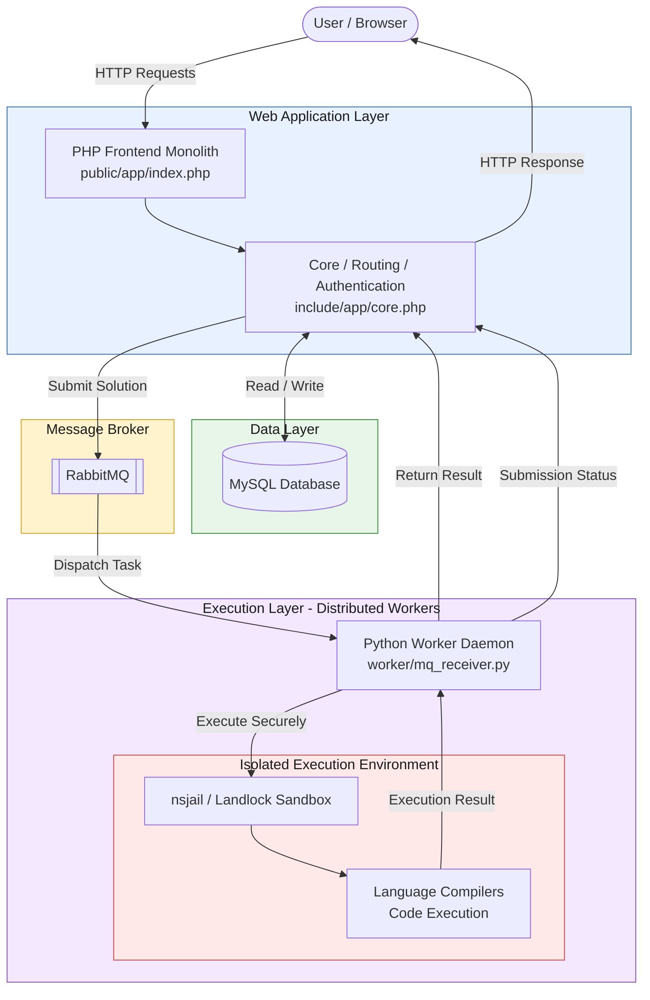

# Contributing
The goal of this document is to provide everything you need to start contributing to ESIT.

Remember that there are many ways to contribute other than writing code: writing tutorials or blog posts, building the documentation, submitting bug reports and feature requests...

If ESIT does not offer optimized support for your language, you can add your language too! For this purpose you can use for example [poedit desktop app](https://poedit.com/download/).

It is assumed that when contributing, you are familiar with [GitHub](https://docs.github.com/en/) and the [PR (Pull Requests)](https://docs.github.com/en/pull-requests/reference/pull-requests) workflow.

## Table of contents
- [Use of generative AI tools](#use-of-generative-ai-tools)
- [System architecture](#system-architecture)

## Use of generative AI tools
**It is required that you transparently disclose any usage of generative AI tooling (GitHub Copilot, ChatGPT, Claude Code, Cursor, etc.) in contributions, if it was used to generate code.**

## System architecture

