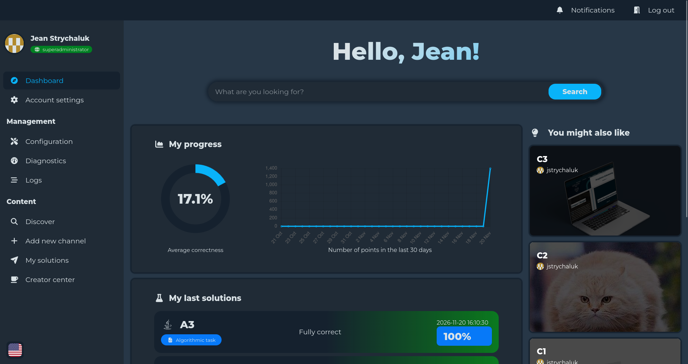
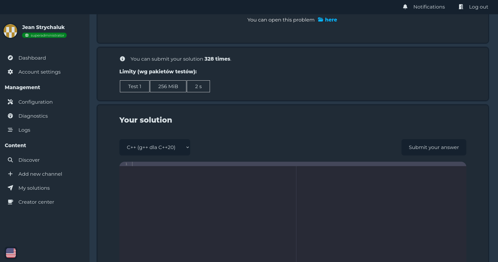
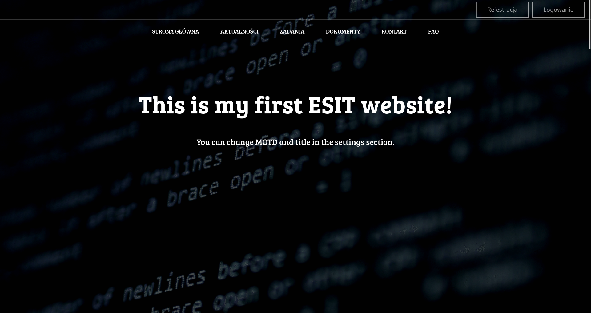

#   ESIT

<p align="center">


<a href="https://www.codefactor.io/repository/github/jstpp/esit"></a>
<a href="https://securityscorecards.dev/viewer/?uri=github.com/jstpp/ESIT"></a>
</p>

🇺🇸 `ESIT` is an online platform for cybersecurity and algorithmics labs (part of "Open Computer Science Project"). Measure execution time and limit memory inside nsjail-based sandbox environments. Divide your content into sets of exercises and show your results with scoreboards. Extend and customize platform features with community plugins from GitHub.

🇵🇱 `ESIT` to projekt internetowych laboratoriów cyberbezpieczeństwa i algorytmiki przygotowywany w ramach projektu "Otwarta Informatyka". Mierz czas i ograniczaj zasoby w bezpiecznym, izolowanym środowisku bazowanym na nsjail. Dziel treści na zestawy i pokazuj wyniki w czytelny sposób. Dowolnie rozszerzaj i personalizuj swoją aplikację za pomocą społecznościowych pluginów.



## Purpose

ESIT is a platform for organizing contests, exams, courses and other similar forms related to computer science and/or cybersecurity. It has multiple functions and is highly customizable, which may suit different purposes.

> [!important]
> The project is significantly more reliable than before, but keep in mind that you are using this software at your own risk.

## Installation

Download the repository:

```bash
git clone https://github.com/jstpp/esit.git && cd esit
```

You can customize the [config file](include/app/core.php). You should consider this when running it in production, otherwise, you can ignore it.

Start [installation script](./setup/setup.sh):

```bash
source ./setup/setup.sh --install
```

The service will be available on `localhost:80` unless you change it. 

> [!important] 
> The first user to register will automatically become an administrator so it's in your best interest to limit access to web server during initial setup.

> [!tip] 
> To start server again after installation, you don't need run `setup.sh` again. Just use:
> ```bash
> docker compose up
> ```
> with convienent parameters.

## Technical details

### Evaluation of algorithmic solutions

ESIT uses [nsjail](https://github.com/google/nsjail) to isolate algorithmic solutions and uses default mechanisms of compilers or OS to measure the parameters of compilation. Currently, it supports **Python** (3.13), **C++** (C++20) and **Java** (OpenJDK 25).



To run algorithmic solutions on your instance make sure you have functional worker with **IP address added to whitelist**. You can do it easily with with app's graphical interface. Some architectures may have problems with runnning nsjail which can be detected with tests suite (`/worker/tests/`) running during every worker's startup. When any of basic tests is failed - the worker stops (web application may be still online).

### Evaluation of CTF solutions

ESIT's support for CTF solutions is limited (at the moment) to cases where the flag is hidden inside a single file. Hosting more sophisticated challenges in [nsjail](https://github.com/google/nsjail) is planned in the future.

### Evaluation of other types of content

ESIT also supports:

- writing tasks (with LaTeX support)
- single choice tests
- multiple choice tests

### Portal functions are disabled by default

To enable the portal and all related features, enable the "portal" system plugin and update your settings. Once the plugin is enabled, you'll be able to use the default template as your main site.



## Custom configuration

Check the ESIT custom configuration options [here](setup/README.md). After successful installation, you can install community plugins from github using app's graphical interface. Would you like to add your own plugin? Create GitHub repo with `esit-plugins` tag. Read [more about community plugins](include/app/plugins/README.md).

> [!tip]
> Be carefull when using community plugins from GitHub. Repositories with `esit-plugins` are not verified so make sure you trust the code you are about to install and run on your instance.

> [!tip]
> It is recommended to use ESIT behind reverse proxy with HTTPS. You should setup it on your own (using software like [nginx](https://github.com/nginx/nginx)).

> [!tip]
> When customizing your ESIT instance, it can be helpful to run the worker's test suite as well as the built-in diagnostics tool that tests specific parts of the web application.

## Translation & contributing
### Contribute
Would you like to contribute? Check out [contributing guidelines](CONTRIBUTING.md). Moreover, here is a roadmap indicating goals to be achieved in the future:

- [ ] Roles customizable with GUI
- [ ] Customizable portal templates
- [ ] Distributed workers network
- [ ] Automatic verification of content creators
- [ ] WCAG 2 compliance
- [ ] Updates system

<br />
<a href="https://deepwiki.com/jstpp/ESIT"></a>


### Translate
Feel free to add translations. Currently supported languages: 🇺🇸 `English`, 🇵🇱 `Polish`.

## More information

For more information see:

- [worker info](worker/README.md),
- [plugins](include/app/plugins/README.md),
- [installation example & custom configuration details](setup/README.md),
- [MIT license](LICENSE),
- [security annotations](SECURITY.md),
- [contributing guidelines & system architecture](CONTRIBUTING.md).

 <br />

---

 <br />

*Projekt "Otwarta Informatyka" realizowany w ramach programu "Uczelnie Przyszłości" finansowanego z Funduszy Europejskich dla Rozwoju Społecznego.*


